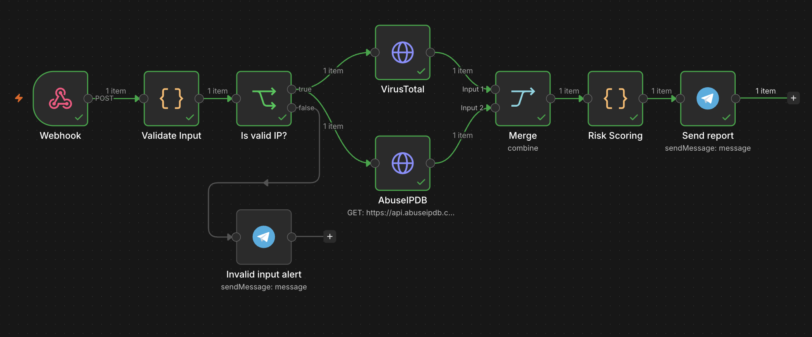
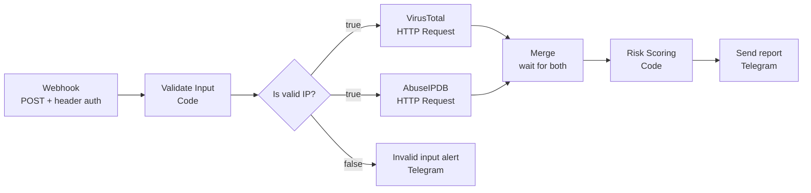
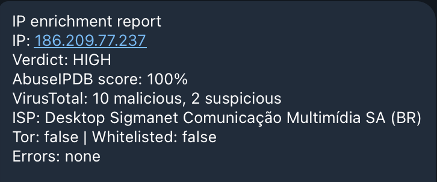
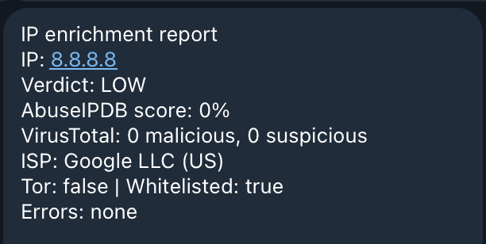
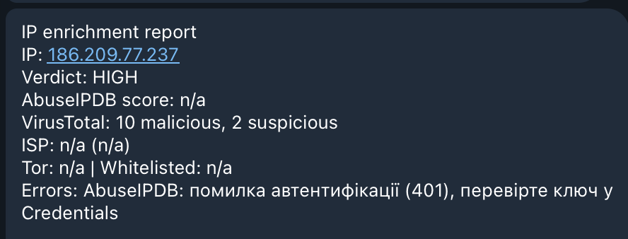
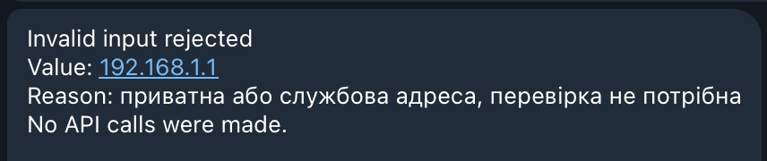
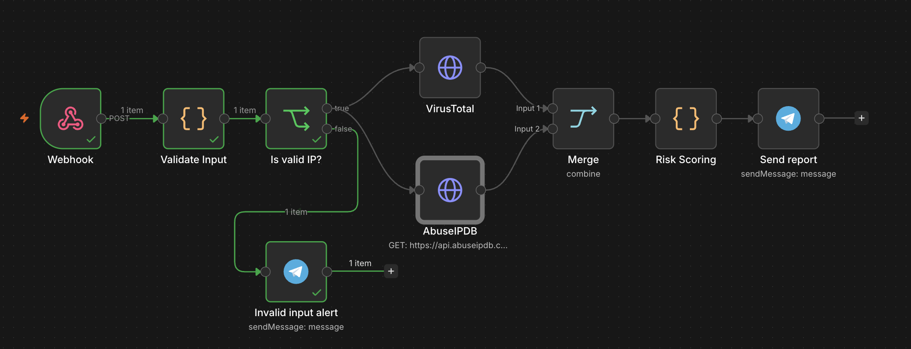
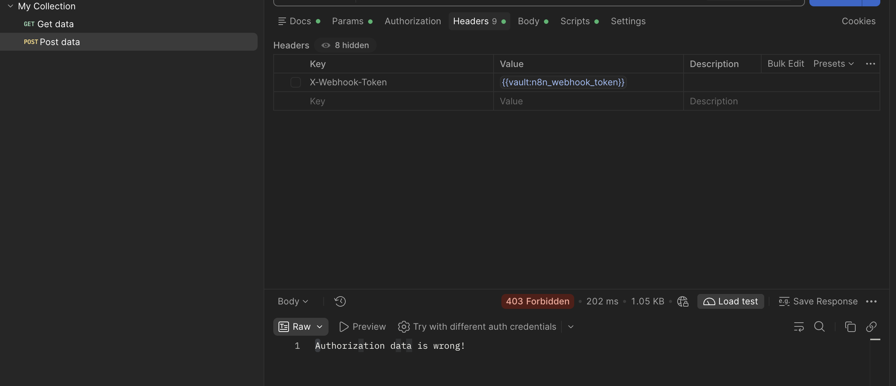

# IP Reputation Enrichment with n8n

An n8n workflow that receives a suspicious IP address via webhook, validates it, queries two threat intelligence sources in parallel (AbuseIPDB and VirusTotal), calculates a risk verdict and sends a short report to Telegram.

Built as a portfolio project to demonstrate REST API integration, API-key authentication, playbook logic, error handling and secure handling of secrets in a security automation workflow.



---

## Problem

During alert triage a SOC analyst often has to check the same IP manually in several reputation services, compare the results and decide whether to escalate. This workflow automates that first enrichment step so the analyst receives one consolidated verdict in seconds.

## Architecture



## How it works

| # | Node | What it does |
|---|------|--------------|
| 1 | **Webhook** | Accepts `POST {"ip": "x.x.x.x"}`. Requires a secret header (`X-Webhook-Token`), so the public URL cannot be abused. Responds immediately (asynchronous model). |
| 2 | **Validate Input** | Treats input as untrusted: checks that the value is a valid public IPv4 address. Private, loopback, link-local, CGNAT and multicast ranges are rejected, so internal addresses are never sent to third-party services. |
| 3 | **Is valid IP?** (IF) | Routes valid input to enrichment and invalid input to the **Invalid input alert**. No API calls are made for invalid input. |
| 4 | **VirusTotal** | `GET /api/v3/ip_addresses/{ip}`, API key in the `x-apikey` header via n8n Credentials. |
| 5 | **AbuseIPDB** | `GET /api/v2/check?ipAddress={ip}&maxAgeInDays=90`, API key in the `Key` header via n8n Credentials. |
| 6 | **Merge** | Synchronisation point: waits until both API branches finish. |
| 7 | **Risk Scoring** | Reads both responses by node name (avoids field collisions after merge), checks HTTP status codes and calculates the verdict. |
| 8 | **Send report** (Telegram) | Sends the report to the analyst. |

Both HTTP Request nodes use **Never Error + Include Response Headers and Status**, so an API failure does not stop the workflow. The status code is evaluated in the scoring step instead.

## Scoring logic

| Verdict | Condition |
|---------|-----------|
| `HIGH` | AbuseIPDB confidence score ≥ 50 **or** VirusTotal malicious detections ≥ 3 |
| `MEDIUM` | AbuseIPDB score ≥ 20 **or** at least 1 malicious or suspicious detection on VirusTotal |
| `LOW` | none of the above, both sources answered |
| `LOW (неповні дані)` | looks clean, but one of the sources failed: the analyst should not treat it as confirmed clean |
| `UNKNOWN` | both sources failed |

Key principle: **missing data is not the same as "no threat"**. A failed lookup never silently becomes `LOW`. One strong signal is enough for `HIGH`, even if the other source is unavailable.

Thresholds are defined as constants at the top of [`code/risk_scoring.js`](code/risk_scoring.js) and can be tuned in one place.

## Error handling

| HTTP status | Meaning | Message in report |
|-------------|---------|-------------------|
| 200 | OK | – |
| 401 / 403 | Invalid or revoked API key | authentication error, check Credentials |
| 429 | Rate limit exceeded | rate limit reached |
| 400 / 422 | Malformed request | invalid request, check IP format |
| 404 | Resource not found | data not found |
| other | Unexpected response | unexpected response with code |

Observed behaviour worth noting: for the same invalid input (`abc`) VirusTotal returned **404** and AbuseIPDB returned **422**. Different APIs react differently to bad input, which is why validation is done before any API call.

## Security design

- **No secrets in the workflow.** API keys, the Telegram bot token and the webhook secret are stored in n8n Credentials. The exported JSON contains only credential references.
- **Authenticated webhook.** Requests without the correct `X-Webhook-Token` header are rejected by n8n with `403 Forbidden` ("Authorization data is wrong!") before the workflow starts. Nothing is executed and no API quota is spent. The token is a 256-bit random value (`openssl rand -hex 32`).
- **Secrets on the client side too.** For tests the token is loaded into a shell variable from the clipboard (`$(pbpaste)`), so it never appears on screen or in shell history.
- **Input validation before external calls.** Untrusted input is never placed into an outgoing URL without checking it first. This prevents wasted quota and manipulation of the request path that is sent with the API key.
- **No internal data leakage.** Private and reserved IP ranges are rejected, so internal addresses are not disclosed to external services.
- **Test data only.** All tests used public IPs and personal test accounts. No corporate data was used.
- **Sanitised export.** Before publishing, the workflow JSON was scanned for secrets and identifiers: Telegram chat_id replaced with a placeholder, n8n `instanceId` redacted, no pinned execution data.

## Example outputs

| Scenario | Screenshot |
|----------|------------|
| Malicious IP, both sources agree |  |
| Well-known IP (8.8.8.8): noisy feeds, clean aggregated scores |  |
| One source failed (simulated 401) |  |
| Private IP rejected, no API calls made |  |
| Same rejection on the canvas: only the false branch ran, HTTP nodes were not executed |  |
| Request without webhook token rejected |  |

## How to run

### Requirements

- n8n (tested on n8n Cloud, version 2.44.4)
- Free accounts and API keys: [AbuseIPDB](https://www.abuseipdb.com/), [VirusTotal](https://www.virustotal.com/)
- A Telegram bot (created with `@BotFather`) and your `chat_id`

Free-tier limits change, so check them on the providers' websites. AbuseIPDB reports the current limit in the `X-RateLimit-Limit` and `X-RateLimit-Remaining` response headers; VirusTotal does not, so a 429 is the only signal.

### Setup

1. Import [`workflow/ip-enrichment.json`](workflow/ip-enrichment.json) into n8n.
2. Create the credentials:

   | Credential | Type | Header name |
   |------------|------|-------------|
   | `AbuseIPDB Key` | Header Auth | `Key` |
   | `VirusTotal Key` | Header Auth | `x-apikey` |
   | `Webhook Secret` | Header Auth | `X-Webhook-Token` |
   | `Telegram SOC Bot` | Telegram API | – |

3. Select these credentials in the corresponding nodes.
4. In both Telegram nodes replace `YOUR_CHAT_ID` with your chat id.

### Test

1. Copy the webhook token from your password manager, then load it into a shell variable without printing it:

   ```bash
   N8N_WEBHOOK_TOKEN=$(pbpaste)      # macOS; token is not shown and not saved in history
   echo ${#N8N_WEBHOOK_TOKEN}        # prints the length only, expected 64
   pbcopy < /dev/null                # clear the clipboard
   ```

2. Click **Execute workflow** in n8n, then send:

   ```bash
   curl -X POST "https://<your-instance>.app.n8n.cloud/webhook-test/ip-enrich" \
     -H "Content-Type: application/json" \
     -H "X-Webhook-Token: $N8N_WEBHOOK_TOKEN" \
     -d '{"ip": "8.8.8.8"}'
   ```

   Expected response: `{"message":"Workflow was started"}` and a report in Telegram.

   **Alternative: Postman Desktop.** Store the token in Postman **Local Vault** (key `n8n_webhook_token`, allowed domain = your n8n instance) and use `{{vault:n8n_webhook_token}}` as the header value. Local Vault secrets stay on the device and are never synced; the restricted domain prevents the secret from being sent anywhere else. Note: the Postman web app cannot resolve Local Vault secrets.

3. Negative test: the same request without the token header returns `403 Forbidden`.

4. Clean up: `unset N8N_WEBHOOK_TOKEN`.

### Test cases

| Input | Expected result |
|-------|-----------------|
| `8.8.8.8` | `LOW` |
| known abusive IP from the AbuseIPDB homepage | `HIGH` |
| `abc` | rejected: not a valid IPv4 address, no API calls |
| `192.168.1.1` | rejected: private address, no API calls |
| valid IP + wrong AbuseIPDB credential | report with AbuseIPDB `401` in Errors, verdict from VirusTotal only |
| request without `X-Webhook-Token` | `403 Forbidden`, workflow not started |

The test URL accepts one call per click on **Execute workflow**. For permanent use, publish the workflow and use the production URL (`/webhook/` instead of `/webhook-test/`).

## Limitations

- IPv4 only, IPv6 is rejected as invalid.
- One IP per request.
- No caching: every request spends API quota.
- Simple threshold scoring, does not consider report age or source reliability.
- Telegram is the only output channel.
- The verdict is a first enrichment step for an analyst, not an automatic blocking decision.

## Roadmap

- [ ] Retry with backoff on 429 / 5xx
- [ ] Warning when `X-RateLimit-Remaining` drops below a threshold
- [ ] Cache recent results to save quota
- [ ] IPv6 support
- [ ] Batch input (list of IPs) with a loop
- [ ] GreyNoise as a third source to reduce false positives from internet-wide scanners
- [ ] Weighted scoring that considers report age (`lastReportedAt`)
- [ ] Synchronous JSON response with the verdict for SIEM/SOAR callers
- [ ] Error workflow (n8n Error Trigger) for unexpected crashes
- [ ] Audit log of every check (Google Sheets or database)
- [ ] HMAC request signing instead of a static token, source IP allowlist

## Lessons learned

- **Raw IOC feeds are noisy.** 8.8.8.8 had 234 AbuseIPDB reports and an old "AsyncRAT C2" entry in VirusTotal crowdsourced context, yet 0 detections and a score of 0. Aggregated scores and cross-checking two sources matter more than a single indicator.
- **Cloud IPs need context.** A Microsoft Azure IP scored 100 on AbuseIPDB. Blocking that single address makes sense, blocking the whole ASN would break legitimate services. That is why ISP is part of the report.
- **Each API authenticates differently.** `Key` vs `x-apikey`, IP in the query string vs in the URL path. The authentication header name always comes from the provider's documentation.
- **`$json` always refers to the previous node.** Inserting a node into the chain changes the data structure for every node after it, so expressions must be updated.
- **Merge can silently overwrite fields.** Both APIs return a top-level `data` object. Reading data by node name in the scoring step avoids that collision.
- **A working request is not always a correct request.** During review I found that `Accept` was sent as a query parameter instead of a header. The API ignored it, so there was no visible error.
- **Order of checks matters.** A request to an inactive test webhook returns `404` before the token is even checked, so a 404 does not prove that authentication works. The negative test has to be run while the webhook is listening.
- **Client-side secret storage has limits.** Postman Local Vault secrets are resolved only by the desktop app, not by the web version. Instead of pasting the token in plain text, I first used `curl` with the token loaded from the clipboard into a shell variable, then moved to Postman Desktop with the secret scoped to the n8n domain. The Vault itself is protected by a separate vault key stored in the macOS Keychain (envelope encryption).
- **A 403 is a clue, not just an error.** When Postman returned 403, the n8n side was already proven correct by a successful `curl` test with the same token, so the problem had to be on the client. The header row had simply not been added. Testing the same secret through two independent clients isolated the fault quickly.

## Repository structure

```
.
├── README.md
├── code/
│   ├── validate_input.js
│   └── risk_scoring.js
├── workflow/
│   └── ip-enrichment.json
└── docs/
    └── screenshots/
```
